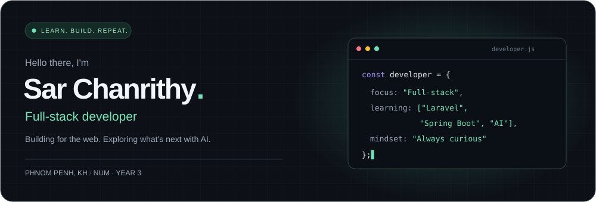
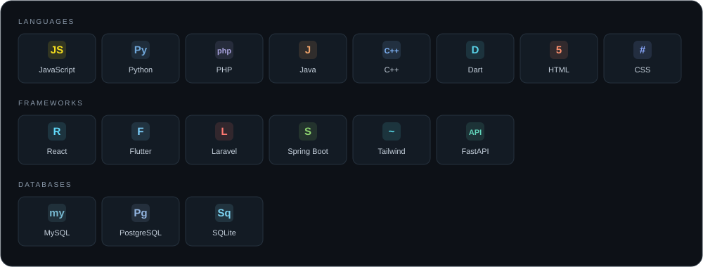
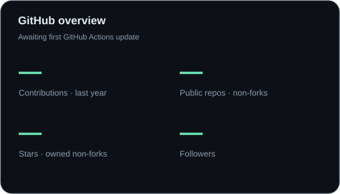
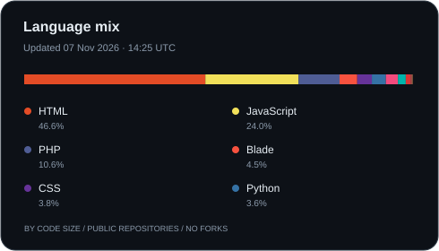
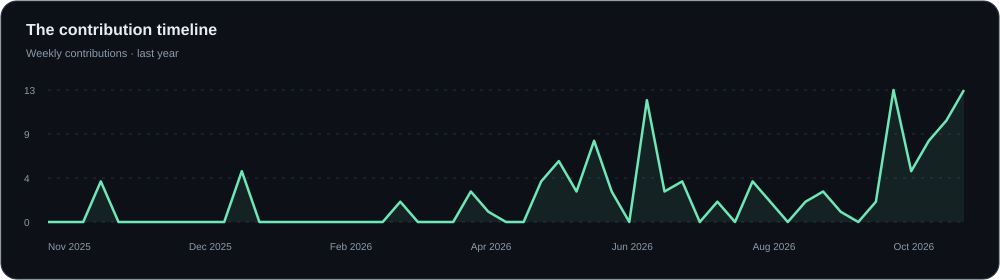
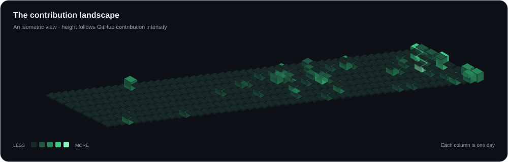
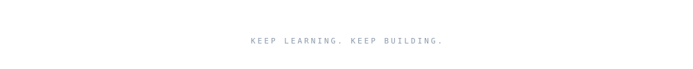



 

<a href="https://github.com/Sar-Chanrithy?tab=repositories">Explore my work</a> &nbsp; / &nbsp;
<a href="https://www.linkedin.com/in/sar-chanrithy-b1896a3a0/">LinkedIn</a> &nbsp; / &nbsp;
<a href="https://t.me/JangWuJi007">Telegram</a>

  

### A little about me

I'm **Sar Chanrithy**, a third-year student at **NUM** in Phnom Penh, Cambodia. 
I build across the web, from interfaces to APIs, and keep learning along the way. 
Currently exploring **Laravel**, **Spring Boot**, and **AI**.

 

**01 &nbsp; / &nbsp; THE TOOLKIT**

### Languages · Frameworks · Tools

  

**02 &nbsp; / &nbsp; BY THE NUMBERS**

### GitHub at a glance

  

**03 &nbsp; / &nbsp; SHOWING UP**

### One contribution at a time

 

Activity over the last year · Language shares measure code size, not proficiency.

  

---

### Let's build something thoughtful.

Open to conversations, learning together, and collaboration.

<a href="https://www.linkedin.com/in/sar-chanrithy-b1896a3a0/">LinkedIn</a> &nbsp; · &nbsp;
<a href="https://t.me/JangWuJi007">Telegram</a> &nbsp; · &nbsp;
<a href="https://github.com/Sar-Chanrithy">GitHub</a>

 

